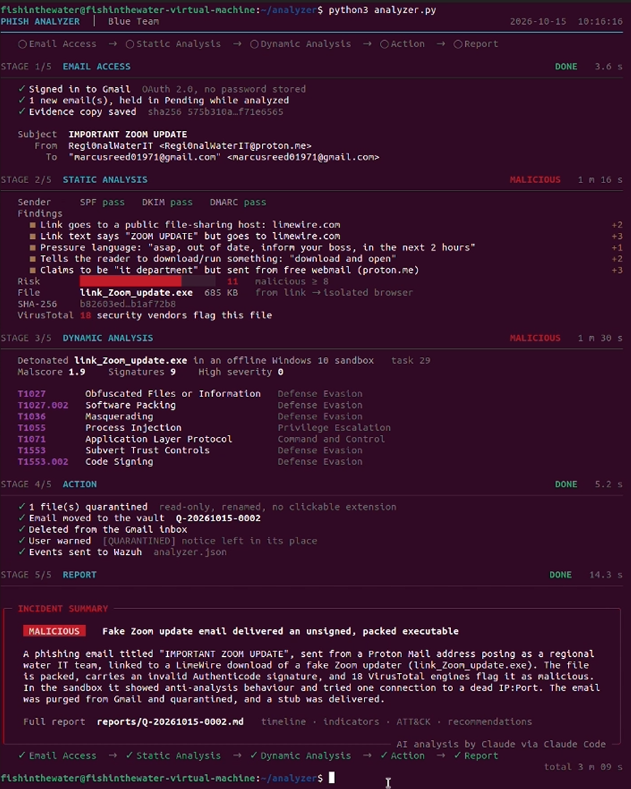
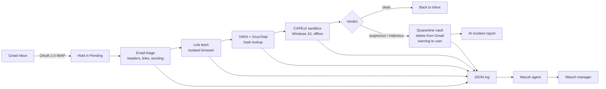
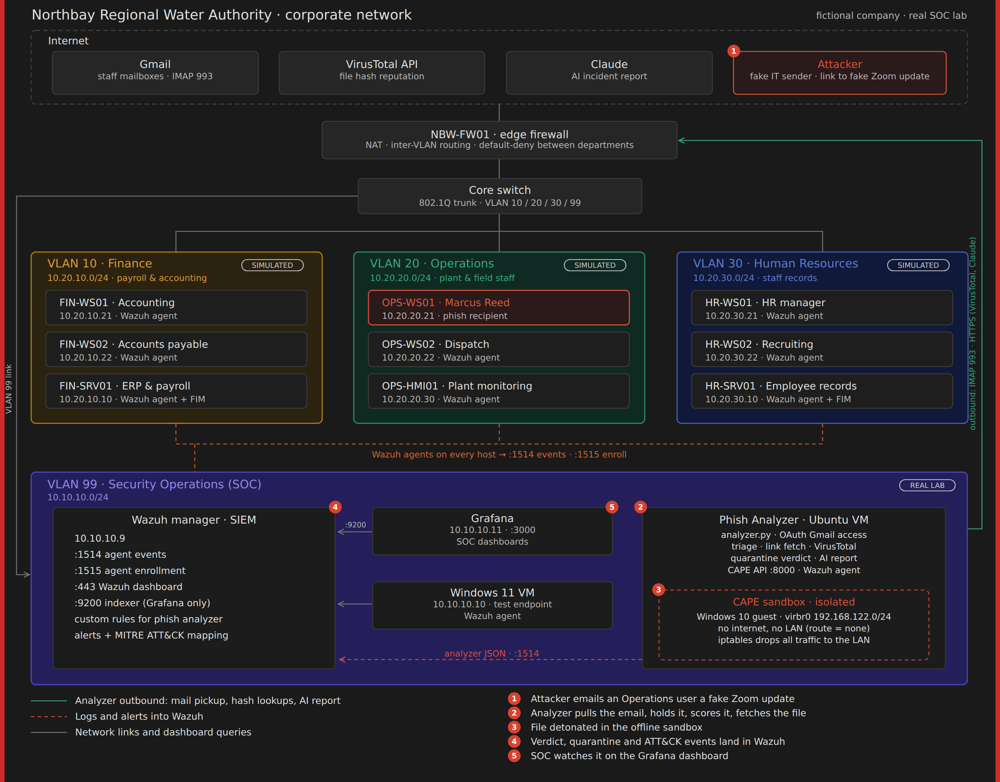

# Phish Analyzer: automated phishing triage, detonation and quarantine

A blue team tool that watches a Gmail inbox and decides whether each new email is phishing. It pulls any
payload the email links to or carries, runs that payload in an isolated Windows sandbox, and removes the email
from the user's mailbox before they can open it. Every step is logged to Wazuh, and an AI-written incident
report closes each case.



*The full run against the red team's "IMPORTANT ZOOM UPDATE" phish: all five stages, from Gmail to the AI incident
summary, in just over three minutes.*

## The five stages

| Stage | What it does |
|---|---|
| **1. Email Access** | Signs in to Gmail with OAuth 2.0, so no password is stored. Moves each new unread email to a `Pending` label while it is analyzed, and records its SHA-256 for chain of custody. |
| **2. Static Analysis** | `phish_triage.py` scores the email: SPF/DKIM/DMARC, sender lookalikes, link text that doesn't match its destination, file-sharing links, free-webmail senders claiming to be IT, pressure and "download and open" wording, and risky attachments. `linkfetch.py` follows links in a headless Chromium and downloads the file behind them, including JavaScript share pages such as LimeWire. Optional YARA rules scan each file, and its hash is looked up on VirusTotal. |
| **3. Dynamic Analysis** | CAPEv2 runs each file in an offline Windows 10 VM, records its behaviour, matches it against YARA rules and CAPE signatures, and maps it to MITRE ATT&CK techniques. |
| **4. Action** | `vault.py` keeps the only copy of a suspicious or malicious email on the analyzer VM (owner-only, hash-verified), deletes it from Gmail, and leaves a plain-text `[QUARANTINED]` notice with a case ID in its place. Analysts can list, audit and release cases. If any step fails, the email stays in `Pending`. |
| **5. Report** | `ai_report.py` writes an incident report: the verdict, the evidence behind it, a timeline, indicators, ATT&CK techniques and recommendations. The AI only receives the findings, never the email body or the file, and it doesn't decide the verdict. See a [sample report](results/sample_report.md). |

Every stage writes JSON events to `~/analyzer/logs/analyzer.json`, which a Wazuh agent ships to a Wazuh manager.
[`docs/how-it-works.md`](docs/how-it-works.md) covers each part in detail: scoring weights, verdict rules,
the quarantine lifecycle, log events and known limits.



## Lab architecture



The company and its three department VLANs are fictional and only set the scene. The SOC VLAN is the real lab.
This repository covers the analyzer VM and its isolated CAPE sandbox. The Wazuh manager, Grafana and the
Windows 11 endpoint are in [Lucas's repo](https://github.com/Lucas952-eng/Wazuh-SIEM-CAPEV2-LAB). The analyzer
reaches the Wazuh manager over Tailscale. An editable SVG of the diagram is in `docs/img/`.

## Lab specs

| Machine | Resources |
|---|---|
| Host | 8 cores / 16 threads, 32 GB DDR5 RAM, 1 TB storage, VMware |
| Ubuntu analyzer VM (analyzer + CAPEv2) | 4 vCPUs, 12 GB RAM, 100 GB disk |
| Windows 10 CAPE guest (KVM, inside the Ubuntu VM) | 2 vCPUs (host-passthrough), 4 GB RAM, 50 GB disk |

CAPE's Windows guest runs inside the Ubuntu VM, so the Ubuntu VM needs nested virtualization turned on
(VMware: *Virtualize Intel VT-x/EPT or AMD-V/RVI*).

The CAPE guest runs a lightweight Windows 10 build from [Windows X-Lite](https://windowsxlite.com/win10) to keep
it small and fast. It's an unofficial, modified build, so use it only for an isolated sandbox. Some malware checks
for a normal-looking Windows install, so a stock Windows 10 image may give more realistic results.

## Building it

**What you need before starting:**

- A PC that can run a 4 vCPU / 12 GB RAM VM with nested virtualization (see [Lab specs](#lab-specs)).
- A Windows 10 ISO for the CAPE guest.
- A Gmail account for the analyzer to watch, and a Google Cloud project (free) for its OAuth client.
- A free VirusTotal account for the API key.
- A Wazuh manager to send events to (optional; the analyzer still logs locally without one).
- Optional: a Claude Pro/Max plan, a Claude API key, or enough RAM for a local Ollama model, for the AI report.

The CAPE sandbox is the longest part of the build. The analyzer itself takes about an hour once CAPE works.

The full walkthrough is in [`docs/setup.md`](docs/setup.md). In short:

1. **Analyzer VM:** Ubuntu with nested virtualization on.
2. **CAPEv2:** installed by following the three-part guide by [@rizqisetyokus](https://medium.com/@rizqisetyokus)
   ([part 1](https://medium.com/@rizqisetyokus/building-capev2-automated-malware-analysis-sandbox-part-1-da2a6ff69cdb),
   [part 2](https://medium.com/@rizqisetyokus/building-capev2-automated-malware-analysis-sandbox-part-2-0c47e4b5cbcd),
   [part 3](https://medium.com/@rizqisetyokus/building-capev2-automated-malware-analysis-sandbox-part-3-d5535a0ab6f6)),
   with a Windows 10 guest labelled `win10`. The config changes are in [`sandbox/cape-config.md`](sandbox/cape-config.md). Then isolate it as in [`sandbox/isolation.md`](sandbox/isolation.md).
3. **Analyzer:** copy `analyzer/*.py` to `~/analyzer/` and `oauth/*.py` to `~/analyzer/oauth/`, then install the
   requirements and Chromium for Playwright.
4. **VirusTotal:** a free API key in `~/analyzer/secrets.env`.
5. **Gmail:** a Google Cloud OAuth client (Desktop app, scope `https://mail.google.com/`), then a one-time sign-in
   with `oauth/auth_setup.py`.
6. **Wazuh agent:** pointed at your manager and watching `analyzer.json`. Example rules are in
   [`wazuh/local_rules.example.xml`](wazuh/local_rules.example.xml).
7. **AI report (optional):** Claude Code CLI, a Claude API key, or a local Ollama model. Without one, the report
   comes from a template.
8. **YARA (optional):** `pip install yara-python` and rules in `~/analyzer/yara/`.

## Usage

```bash
cd ~/analyzer
set -a; source secrets.env; set +a

python3 new_analyzer.py                              # analyze new unread emails
python3 new_analyzer.py --eml path/to/email.eml      # analyze a saved email, Gmail untouched
python3 new_analyzer.py --list-quarantine            # every quarantine case and its status
python3 new_analyzer.py --custody Q-YYYYMMDD-NNNN    # chain of custody, re-checks the hash
python3 new_analyzer.py --release Q-YYYYMMDD-NNNN    # false positive: put the email back
python3 new_analyzer.py --release-file <sha256>      # restore one quarantined file
python3 new_analyzer.py --plain                      # line-by-line output instead of the stage view
python3 ai_report.py --subject "Email subject"       # rebuild a report for one email
```

Use a terminal at least 104 columns wide for the stage view. `CAPE_ALWAYS = True` near the top of
`new_analyzer.py` sends every file to CAPE, even when VirusTotal is already conclusive; set it to `False` to skip
detonation when 5 or more engines already flag the file.

## Testing against a red team attack

The analyzer was tested against a red team's phishing attack. They sent a fake IT "IMPORTANT ZOOM UPDATE" email
from a real Proton Mail account, so **SPF, DKIM and DMARC all passed**. The email linked to a Windows executable
on LimeWire, protected by a decryption key in the link.

| Layer | Result |
|---|---|
| Sender authentication | Missed: a real account passes every check |
| Email triage | Caught: risk score 11 (malicious ≥ 8) |
| Link fetch | Downloaded `Zoom_update.exe` (685 KB) from the share page |
| VirusTotal | 18 vendors flagged the file |
| CAPEv2 | Malscore 1.9 (low because the sandbox is offline), 9 signatures; ATT&CK T1027, T1036, T1055, T1071, T1553 |
| Quarantine | Email vaulted, deleted from Gmail, user warned, payload quarantined |
| Wazuh | Every stage's events delivered to the Wazuh manager |

**Full run (video).** The whole chain against the red team's email: the phish arrives in Gmail, the analyzer
runs all five stages, and the inbox ends up holding only the quarantine notice. The file is also in
[`results/full_run.mp4`](results/full_run.mp4).

https://github.com/user-attachments/assets/4514d2a3-97a5-42cc-b370-1b7eddbca7f3

During testing, a real "You Have Been Qualified" phish with a PDF attachment also arrived, from what looked like
a compromised account. Authentication passed and the triage score was 0, but a high-severity YARA signature in
CAPE marked it suspicious, so it was quarantined.

## Repository layout

```
analyzer/        the tool
  new_analyzer.py    main script: the five stages and the command-line options
  phish_triage.py    email scoring (Stage 2)
  linkfetch.py       link following and file download (Stage 2)
  vault.py           quarantine, release and chain of custody (Stage 4)
  ai_report.py       AI incident report (Stage 5)
  display.py         the five-stage terminal view (rich)
oauth/           one-time Gmail sign-in (local, or remote when the inbox owner is elsewhere)
sandbox/         CAPE config changes and how the sandbox is isolated from the network
wazuh/           Wazuh agent notes and example manager rules
docs/            setup guide, how each part works, and the lab diagram
samples/         two harmless test emails (reserved .example domains)
results/         screenshot, video and AI report from real runs (redacted)
```

## Safety

- Run this only inside an isolated lab. The analyzer downloads live malware by design.
- The CAPE guest has no route out: CAPE routing is `none`, and host firewall rules drop guest traffic to the
  LAN, Tailscale and private ranges ([`sandbox/isolation.md`](sandbox/isolation.md)).
- Payloads are saved with restricted permissions and never executed on the analyzer VM.
- The AI report runs with all tools disabled and only sees the findings.
- No secrets, real emails, payloads or logs are in this repository. Run `./check_secrets.sh` before every push.

## Credits

Built by Brian as the email-defence half of a blue team lab. The SIEM side (Wazuh manager, rules and Grafana
dashboards) is Lucas's project: [Wazuh-SIEM-CAPEV2-LAB](https://github.com/Lucas952-eng/Wazuh-SIEM-CAPEV2-LAB).
CAPEv2 setup follows the guide by [@rizqisetyokus](https://medium.com/@rizqisetyokus) on Medium.
Built with CAPEv2, VirusTotal, Wazuh, Playwright, rich, imap-tools, Google OAuth and Claude.

Released under the MIT License (`LICENSE`).
